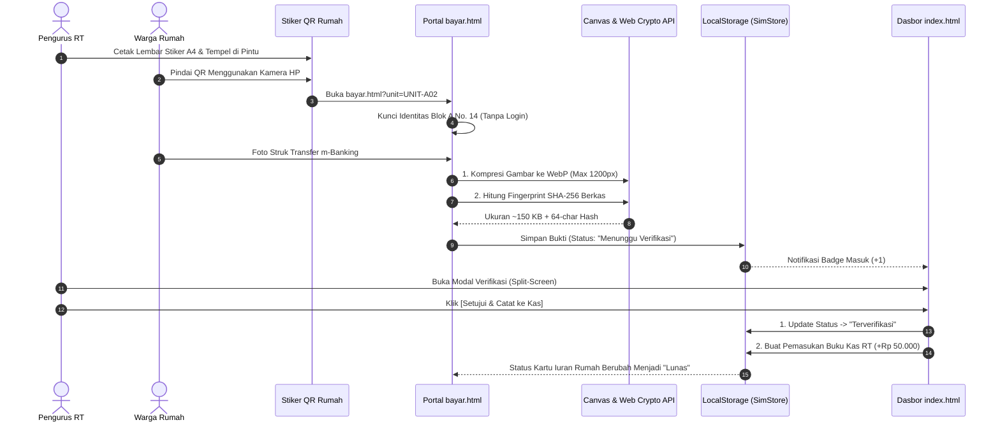
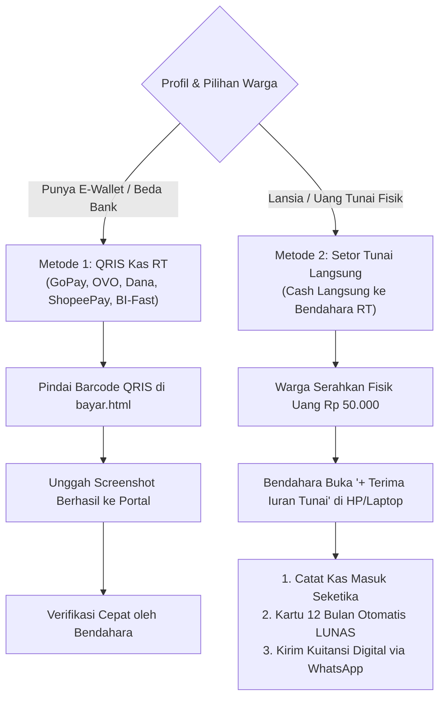

# Alur Kerja Pembayaran QR Code & Anti-Duplikasi (Tahap 1)

Dokumen ini mendokumentasikan secara rinci implementasi teknis dari **Tahap 1**: mulai dari pembuatan stiker QR, penanganan unggahan struk di sisi peramban, kompresi berkas, penghitungan *hash* anti-duplikasi, hingga verifikasi dan pembukuan kas.

---

## 1. Siklus Hidup Transaksi Bukti Bayar



---

## 2. Generator & Format Payload Stiker QR

Stiker QR dihasilkan langsung di peramban menggunakan pustaka **QRCode.js** tanpa bergantung pada API eksternal:

### Spesifikasi Payload
* **URL Format:** `bayar.html?unit={UNIT_ID}`
* **Contoh:** `http://localhost/bayar.html?unit=UNIT-A02`
* **Konfigurasi QR:**
  * Ukuran layar: $110 \times 110$ piksel.
  * Ukuran cetak A4: $84 \times 84$ piksel.
  * *Error Correction Level:* Level M (mampu dipindai meski stiker tergores hingga 15%).

### Layout Stiker Siap Gunting
Setiap sel stiker memuat:
1. Nama Wilayah: `RT 03 / RW 07 • Sukamaju`
2. Kotak QR Code aktif
3. Nomor Blok & Rumah tebal: `BLOK A NO. 14`
4. Nama Kepala Keluarga: `Bpk. Hendra Wijaya`
5. Petunjuk pemindaian bagi warga.

---

## 3. Kompresi Gambar Sisi Klien (*Canvas to WebP*)

Kamera smartphone modern umumnya menghasilkan gambar berukuran 4 MB hingga 12 MB dengan resolusi di atas $4000 \times 3000$ piksel. Jika diunggah langsung, berkas sebesar ini akan memboroskan kuota warga dan membebani memori peramban.

### Algoritma Kompresi di `bayar.html`:
```javascript
const maxDim = 1200; // Batas dimensi terpanjang
let width = img.width;
let height = img.height;

if (width > height && width > maxDim) {
  height = Math.round((height * maxDim) / width);
  width = maxDim;
} else if (height > maxDim) {
  width = Math.round((width * maxDim) / height);
  width = maxDim;
}

canvas.width = width;
canvas.height = height;
const ctx = canvas.getContext('2d');
ctx.drawImage(img, 0, 0, width, height);

// Konversi ke WebP kualitas 82%
compressedImageData = canvas.toDataURL('image/webp', 0.82);
```

### Hasil Uji Efisiensi Kompresi:
| Format Asli | Resolusi Asli | Ukuran Asli | Format Akhir | Resolusi Akhir | Ukuran Akhir | Penghematan |
| :--- | :--- | :--- | :--- | :--- | :--- | :---: |
| **JPEG** | $4032 \times 3024$ | 5.2 MB | **WebP** | $1200 \times 900$ | **164 KB** | **96.8%** |
| **PNG** | $2400 \times 1080$ | 3.8 MB | **WebP** | $1200 \times 540$ | **128 KB** | **96.6%** |

Teks angka nominal transfer, tanggal, dan nomor referensi m-Banking tetap tajam dan terbaca jelas oleh mata maupun mesin OCR.

---

## 4. Mekanisme Kriptografis Anti-Duplikasi (SHA-256)

Untuk mencegah kecurangan (misalnya warga mengunggah kembali tangkapan layar struk bulan lalu atau struk milik tetangga), sistem menerapkan sidik jari kriptografis menggunakan **Web Crypto API**:

```javascript
// Menghitung hash SHA-256 dari ArrayBuffer berkas asli
const arrayBuffer = await file.arrayBuffer();
const hashBuffer = await crypto.subtle.digest('SHA-256', arrayBuffer);
const hashArray = Array.from(new Uint8Array(hashBuffer));
const imageHash = hashArray.map(b => b.toString(16).padStart(2, '0')).join('');
```

### Aturan Validasi Duplikasi:
Sebelum menyimpan ke database:
```javascript
const existing = SimStore.getBuktiBayar().find(b => b.imageHash === imageHash);
if (existing) {
  showToast('Peringatan: Gambar bukti transfer ini terdeteksi sudah pernah diunggah sebelumnya!', 'error');
  return; // Ditolak
}
```

---

## 5. Antarmuka Verifikasi Layar Belah (*Split-Screen*) & Kas Otomatis

Di dasbor pengurus RT ([index.html](../index.html)), proses peninjauan bukti transfer dirancang ergonomis:
* **Sisi Kiri:** Tampilan struk transfer resolusi penuh dengan latar belakang kontras tinggi (*dark slate*).
* **Sisi Kanan:** Ringkasan data unit rumah, nominal, periode, dan kotak evaluasi OCR.
* **Aksi 1-Klik [Setujui & Catat ke Kas]:**
  1. Mengubah `statusVerifikasi` bukti menjadi `'Terverifikasi'`.
  2. Memanggil `SimStore.addTransaksi({ tipe: 'Pemasukan', nominal: ..., kategori: 'Iuran Bulanan' })`.
  3. Mengaitkan ID transaksi (`transaksiId`) ke bukti bayar untuk mendukung fitur pembatalan (*rollback*).
  4. Memperbarui total saldo kas di seluruh dasbor seketika.

---

## 6. Alur Pembayaran Multi-Bulan & Validasi Ganda (Hasil Persetujuan)

### A. Pembayaran Sekaligus (Multi-Bulan)
Warga dapat memilih opsi pembayaran 1, 2, 3, 6, atau 12 bulan sekaligus. Sistem secara otomatis:
1. Mengalikan tarif iuran bulanan wajib dengan jumlah bulan yang dipilih ($\text{Nominal} = \text{Tarif} \times N$).
2. Menyimpan daftar bulan dalam format terstruktur (contoh: `"2026-10, 2026-11, 2026-12"`).
3. Saat diverifikasi, matriks laporan 12 bulan per blok menandai seluruh bulan yang bersangkutan sebagai `LUNAS`.

### B. Validasi Ganda Anti-Kecurangan (Hash + Ref Bank)
Mencegah celah di mana warga memfoto ulang struk lama dari sudut berbeda:
* **Cek 1:** SHA-256 berkas gambar WebP.
* **Cek 2:** Nomor Referensi Bank / RRN (apabila diisi) diperiksa agar tidak pernah dipakai ulang pada transaksi sebelumnya.

---

## 7. Verifikasi Massal, Notifikasi WhatsApp, & Rollback Kas

### A. Persetujuan Massal (*Batch Approval*)
Untuk mempercepat kerja bendahara pada awal bulan, disediakan tombol **"✓ Setujui Semua yang Lulus Otomatis"**. Seluruh bukti berstatus `'Menunggu Verifikasi'` dengan evaluasi valid langsung disetujui dan dibukukan ke kas dalam satu tindakan.

### B. Respon Balik WhatsApp Terintegrasi
Disediakan tombol langsung untuk mengirim pesan via WhatsApp API (`https://wa.me/...`):
* **Tanda Terima Sah:** Dikirimkan ke warga begitu iuran disetujui.
* **Penjelasan Penolakan:** Dikirimkan ke warga jika struk ditolak (salah nominal/bukan struk yang sah).

### C. Fitur Pembatalan (*Undo / Rollback*)
Jika bendahara tidak sengaja salah menyetujui bukti bayar:
1. Bendahara dapat menekan tombol **"Batalkan Verifikasi"**.
2. Sistem otomatis menghapus mutasi pemasukan kas terkait dari `transaksi`.
3. Status bukti dikembalikan menjadi `'Menunggu Verifikasi'` dan matriks 12 bulan dikoreksi kembali.

---

## 8. Indikator Status Sinkronisasi Pengurus

Pada antarmuka verifikasi kas pengurus, disediakan indikator:
* Tombol **"Sinkronkan / Refresh"** dengan catatan waktu: *"Terakhir diperbarui: Baru saja"*.
* Indikator visual hijau yang menandakan sistem siap menerima data dari HP warga.

---

## 9. Alternatif Metode Pembayaran Iuran (Hasil Persetujuan)

Untuk menjangkau keberagaman profil warga (pengguna dompet digital hingga warga lansia/tanpa m-Banking), sistem secara resmi mendukung dua alternatif pembayaran utama:



### A. Prioritas 1: Pembayaran via QRIS Kas RT (Lintas Bank & E-Wallet)
* **Latar Belakang:** Mengatasi kendala biaya admin transfer antarbank (Rp 2.500 s/d Rp 6.500) dan mengakomodasi warga yang lebih aktif menggunakan saldo dompet digital (*GoPay, Dana, OVO, ShopeePay, LinkAja*).
* **Alur Teknis:**
  1. Halaman `bayar.html` menampilkan gambar barcode **QRIS Resmi Kas RT** berdampingan dengan kotak nomor rekening bank.
  2. Warga dapat mengunduh gambar QRIS atau langsung memindai melalui aplikasi perbankan/e-wallet pilihan mereka.
  3. Warga mengunggah tangkapan layar (*screenshot*) bukti transaksi QRIS ke formulir portal.
  4. Mesin validasi mencocokkan nominal dan nomor referensi / RRN QRIS (12 digit angka).

### B. Prioritas 2: Penerimaan & Pencatatan Iuran Tunai Langsung (*Direct Cash Entry*)
* **Latar Belakang:** Mengakomodasi warga lansia, warga yang tidak memiliki ponsel pintar, atau yang lebih nyaman membayar uang tunai langsung ke rumah pengurus RT.
* **Alur Teknis:**
  1. Warga menyerahkan uang tunai fisik ke Bendahara RT.
  2. Bendahara membuka dasbor pengurus (`index.html`) lalu menekan tombol cepat **"+ Terima Iuran Tunai"**.
  3. Bendahara memilih unit rumah warga dan rentang periode bulan yang dibayarkan.
  4. Sistem secara otomatis:
     * Menambahkan mutasi `Pemasukan` ke buku kas RT (`metode: 'Tunai'`, `kategori: 'Iuran Bulanan'`).
     * Menandai bulan-bulan yang dibayar menjadi `LUNAS` pada kartu iuran dan laporan rekapitulasi 12 bulan per blok tanpa memerlukan unggahan struk foto.
     * Menyediakan tombol 1-klik **"Kirim Kuitansi WhatsApp"** untuk mengirimkan tanda terima digital langsung ke nomor WhatsApp warga/keluarganya.

---

## 10. Standar Jurnal Akuntansi Kas RT (Hasil Persetujuan)

Untuk menjamin akuntabilitas pembukuan keuangan saat Musyawarah Warga / Laporan Pertanggungjawaban (LPJ) tahunan, SIMWARGA mengimplementasikan pencatatan kas berpasangan (*double-entry*) dan pemisahan kantong kas (*Kas Bank vs Kas Tunai*).

### A. Jurnal Transaksi per Skenario Pembayaran:

1. **Skenario A — Transfer Bank (BCA) Bulan Rutin (Rp 50.000):**
   * `(D) 1-102 Kas di Bank (BCA Kas RT)` : **Rp 50.000**
   * `(K) 4-101 Pendapatan Iuran Wajib Bulanan` : **Rp 50.000**

2. **Skenario B — Pembayaran Barcode QRIS RT (Rp 50.000):**
   * `(D) 1-103 Kas Penampungan QRIS` : **Rp 50.000**
   * `(K) 4-101 Pendapatan Iuran Wajib Bulanan` : **Rp 50.000**
   * *(Saat auto-settlement ke rekening bank: D 1-102 / K 1-103).*

3. **Skenario C — Pembayaran Setor Tunai ke Bendahara (Rp 50.000):**
   * `(D) 1-101 Kas di Tangan (Kas Tunai)` : **Rp 50.000**
   * `(K) 4-101 Pendapatan Iuran Wajib Bulanan` : **Rp 50.000**

4. **Skenario D — Pembayaran Multi-Bulan (3 Bulan = Rp 150.000 via Transfer):**
   * `(D) 1-102 Kas di Bank (BCA Kas RT)` : **Rp 150.000**
   * `(K) 4-101 Pendapatan Iuran Wajib Bulanan` : **Rp 150.000**
   * *(Keterangan: Iuran Periode 2026-10, 2026-11, 2026-12 — otomatis mencentang lunas ke-3 bulan pada kartu iuran warga).*

5. **Skenario E — Pembatalan / Rollback Verifikasi (Jurnal Koreksi):**
   * `(D) 4-101 Pendapatan Iuran Wajib Bulanan (Koreksi)` : **Rp 50.000**
   * `(K) 1-102 Kas di Bank (BCA Kas RT)` : **Rp 50.000**

### B. Pemisahan Kantong Kas (*Cash Breakdown*):
Dasbor keuangan menampilkan pemisahan real-time antara:
$$\text{Total Saldo Kas RT} = \text{Saldo Kas Bank (BCA)} + \text{Saldo Kas Tunai (Bendahara)} + \text{Saldo QRIS}$$
Hal ini memastikan bendahara dapat mencocokkan mutasi fisik uang di dompet kas RT dengan mutasi buku tabungan bank secara presisi.


