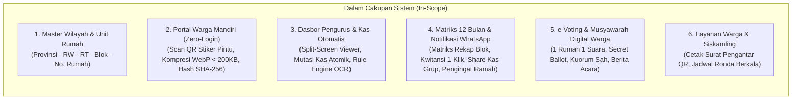
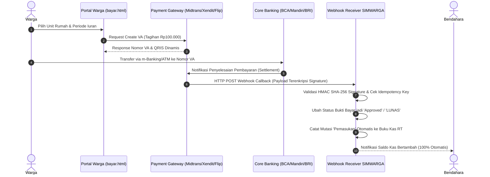
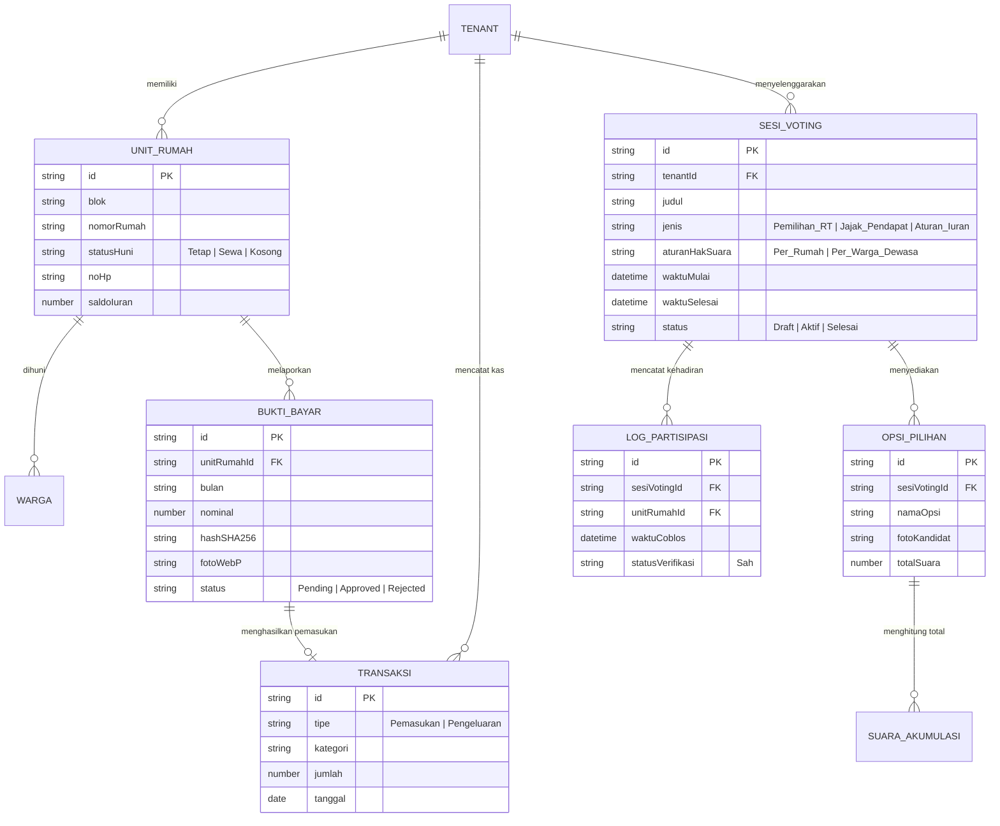

# 📄 Analisis Persyaratan & Cakupan Sistem: SIMWARGA

Dokumen ini merupakan panduan master rekayasa perangkat lunak (*Software Requirements Specification* & *Project Scope Management Document*) untuk sistem **SIMWARGA (Sistem Informasi Manajemen Data Warga, Iuran QR, e-Voting Musyawarah & Keuangan RT/RW)**.

---

## 1. Identitas Dokumen & Informasi Proyek

| Parameter | Keterangan |
| :--- | :--- |
| **Nama Proyek** | Sistem Informasi Manajemen Warga, Iuran QR & e-Voting (SIMWARGA) |
| **Kode Proyek** | `PRJ-SIMWARGA-2026` |
| **Versi Dokumen** | 1.2.0 |
| **Tanggal Pembaruan** | 31 Oktober 2026 |
| **Prinsip Dasar Arsitektur** | *Dual-Mode: Client-Side Standalone First & Hosted Static-First*, Zero-Login Warga, Multi-Tenancy Hierarkis Wilayah |

---

## 2. Latar Belakang & Pernyataan Masalah

Pengelolaan administrasi di tingkat Rukun Tetangga (RT), Rukun Warga (RW), maupun paguyuban perumahan/kompleks menghadapi tantangan operasional klasik:
1. **Penarikan & Verifikasi Iuran Manual:** Penagihan fisik pintu-ke-pintu tidak efisien. Pengiriman struk via grup WhatsApp sering tertimbun chat, berisiko struk ganda (*fraud duplikasi*), dan menyulitkan bendahara mencocokkan mutasi rekening.
2. **Keterbatasan Transparansi Kas Lingkungan:** Rekapitulasi kas lambat diumumkan ke warga, memicu kecurigaan dan penurunan rasio pembayaran iuran.
3. **Penyelenggaraan Musyawarah & Pemilihan Pengurus:** Kehadiran rapat tatap muka sering kali tidak mencapai kuorum karena kesibukan warga; belum ada sarana e-voting terpercaya yang menjamin kerahasiaan pilihan (*secret ballot*) dan mencegah kecurangan suara ganda.
4. **Ketiadaan Layanan Cepat Administrasi:** Warga membutuhkan surat pengantar kilat dan kwitansi resmi tanda lunas tanpa harus menunggu pertemuan fisik dengan pengurus.

---

## 3. Analisis Pemangku Kepentingan (*Stakeholder Analysis*)

| Persona | Peran Utama | Kebutuhan Utama | Nilai Tambah yang Dihasilkan |
| :--- | :--- | :--- | :--- |
| **Warga / Penghuni** | Membayar iuran, memantau riwayat kartu iuran, menyalurkan hak suara musyawarah RT. | Portal bayar kilat via scan QR pintu tanpa login; hak suara digital yang rahasia, sah, dan transparan. | Kemudahan bayar $< 45\text{ detik}$, kwitansi instan di WhatsApp, dan tidak kehilangan hak suara saat berhalangan hadir fisik. |
| **Bendahara RT** | Memverifikasi pembayaran warga, membukukan mutasi kas, menerbitkan laporan keuangan. | Dasbor verifikasi *split-screen*, pembukuan otomatis, generator laporan kas ke grup WhatsApp. | Eliminasi pencatatan manual; saldo kas selalu klop secara *real-time*. |
| **Ketua & Sekretaris RT** | Memantau kas umum, sensus kependudukan, menerbitkan surat pengantar, menyelenggarakan pemilu RT. | Dasbor rekapitulasi blok, generator surat ber-QR validasi, platform e-voting berkuorum resmi. | Pengambilan keputusan lingkungan sah berdasar data; efisiensi waktu layanan warga. |
| **Koordinator Keamanan / Ronda** | Menjaga ketertiban lingkungan dan pos siskamling. | Jadwal ronda adil per blok dan buku mutasi kejadian darurat. | Transparansi giliran jaga malam dan kemudahan pelaporan insiden. |

---

## 4. Batasan Cakupan Sistem (*System Scope Boundaries*)



### 4.1 Cakupan Pekerjaan (*In-Scope*)
1. **Hierarki Wilayah & Multi-Tenancy:** Isolasi data berdasarkan `Kelurahan` $\rightarrow$ `RW` $\rightarrow$ `RT` $\rightarrow$ `Blok` $\rightarrow$ `Nomor Rumah`.
2. **Portal Pembayaran Warga (`bayar.html`):** Akses pemindaian stiker QR rumah tanpa kata sandi, kompresi otomatis WebP ($\le 200\text{ KB}$), dan sidik jari kriptografis SHA-256 anti-duplikasi.
3. **Dasbor Verifikasi & Buku Kas (`index.html`):** Verifikasi berdampingan (*split-screen*), asisten pendeteksi teks transfer (*OCR Rule Engine*), serta pembukuan otomatis transaksi 'Pemasukan' saat disetujui.
4. **Matriks Rekapitulasi Iuran 12 Bulan & Jembatan WhatsApp:** Visualisasi warna status pembayaran per rumah (Jan–Des), generator kwitansi digital 1-klik, penyiaran rekap neraca kas bulanan ke grup WhatsApp warga, dan pengingat iuran santun personal.
5. **e-Voting & Musyawarah Warga Internal:** Pengelolaan jajak pendapat dan pemilihan Ketua RT/RW dengan prinsip *1 Rumah 1 Suara*, pemisahan daftar hadir dengan pilihan coblosan (*Secret Ballot*), serta tabulasi grafis dan Berita Acara otomatis.

### 4.2 Di Luar Cakupan (*Out-of-Scope*)
* ⚠️ **Integrasi Langsung ke Core Banking / Payment Gateway (Fase Awal Out-of-Scope, Masuk Roadmap Fase Lanjutan):** Pada fase awal (MVP/Fase 1), sistem fokus pada alur transfer bank manual dengan bukti struk WebP + verifikasi visual bendahara guna menghindari biaya transaksi per rumah dan mempertahankan sifat *standalone offline-first*. Spesifikasi teknis, skema Virtual Account, dan analisis kelayakan transisi menuju Payment Gateway disajikan secara mendalam pada **Bagian 6**.
* ❌ **Infrastruktur Pemilu Nasional / KPU:** Sistem **tidak mencakup** spesifikasi pemilihan umum tingkat nasional/daerah (tanpa integrasi server KPU pusat, tanpa enkripsi perangkat keras pemilu berstandar militer). Cakupan sistem difokuskan khusus pada **musyawarah internal, jajak pendapat warga, dan pemilihan pengurus RT/RW setempat**.
* ❌ Pembelian perangkat keras (printer, smartphone, stiker laminasi) diserahkan ke kas operasional pengurus.

### 4.3 Batasan Teknis & Prinsip Operasional (*Constraints*)
> [!IMPORTANT]
> 1. **Prinsip Dual-Mode (Client-Side Standalone First & Hosted Static-First):**
>    * **Mode Standalone (`file:///`):** Aplikasi wajib dapat dibuka langsung via klik ganda `index.html` dan `bayar.html` tanpa ketergantungan runtime server lokal (Node.js/PHP/Python) dan tanpa menggunakan ES Module lintas file untuk mencegah galat CORS.
>    * **Mode Web Hosting (`https://`):** Aplikasi wajib dapat di-deploy sebagai situs statis murni (*Jamstack/Edge*) pada CDN gratis/hemat (Cloudflare Pages, Vercel, Netlify, GitHub Pages) tanpa backend server monolitik di sisi web.
> 2. **Pola Abstraksi Penyimpanan (*Storage Adapter Pattern*):**
>    * Pengelolaan data di `SimStore` menggunakan driver modular: `LocalStorageAdapter` untuk mode lokal offline dan `RemoteSyncAdapter` (BaaS Supabase/Cloudflare D1) saat terhubung ke hosting online untuk sinkronisasi multi-perangkat antar-warga dan pengurus.
> 3. **Penyimpanan Hemat & Skalabel:**
>    * **Mode Lokal:** Bukti struk dikompresi menjadi WebP ($\le 200\text{ KB}$) dan disimpan sebagai Base64 di LocalStorage/IndexedDB.
>    * **Mode Web Hosting:** Bukti struk diunggah langsung (*direct upload*) ke Object Storage (Cloudflare R2/S3/Supabase Storage) via *Presigned URL*; database hanya menyimpan URL publik aman.
> 4. **Konteks Aman (HTTPS) & PWA:**
>    * Di web hosting, HTTPS wajib aktif untuk Web Crypto API, kamera pemindai QR WebRTC, dan Service Worker. Pendaftaran Service Worker wajib dinonaktifkan otomatis jika protokol terdeteksi `file:///`.
> 5. **Integritas Pembukuan:** Bukti bayar yang berstatus ditolak (*Rejected*) sama sekali tidak boleh mencatatkan mutasi kas.

---

## 5. Analisis Persyaratan Sistem

### 5.1 Persyaratan Fungsional (*Functional Requirements - FR*)

| ID Kebutuhan | Modul | Deskripsi Kebutuhan Fungsional | Prioritas |
| :--- | :--- | :--- | :--- |
| **FR-01** | Master Wilayah | Mengelola identitas hierarki alamat wilayah: Kelurahan, RW, RT, Blok, dan Nomor Rumah. | **Must Have** |
| **FR-02** | Stiker QR Rumah | Menghasilkan dan mencetak kumpulan lembar stiker QR Code fisik berukuran A4 untuk seluruh nomor rumah. | **Must Have** |
| **FR-03** | Kompresi Klien | Mengompresi bukti struk transfer di peramban warga menjadi format WebP berukuran $\le 200\text{ KB}$ (lebar maks. $1200\text{ px}$). | **Must Have** |
| **FR-04** | SHA-256 Fingerprint | Menghasilkan sidik jari kriptografi SHA-256 dari berkas struk untuk menolak otomatis pengunggahan struk duplikat/berulang. | **Must Have** |
| **FR-05** | Split-Screen Verifikasi | Menampilkan antarmuka pembanding berdampingan antara foto struk asli dan isian data warga pada dasbor bendahara. | **Must Have** |
| **FR-06** | Kas Masuk Otomatis | Mencatat mutasi transaksi 'Pemasukan' secara atomik ke modul Buku Kas ketika bendahara menyetujui (*Approve*) bukti bayar. | **Must Have** |
| **FR-07** | Matriks Rekap 12 Bulan | Merender tabel rekapitulasi status iuran 12 bulan (Jan–Des) seluruh unit rumah per blok dengan indikator warna status. | **Must Have** |
| **FR-08** | Kartu Iuran Digital | Menampilkan riwayat pembayaran 12 bulan terakhir pada portal warga (`bayar.html`) untuk unit rumah yang bersangkutan. | **Should Have** |
| **FR-09** | Asisten OCR Cerdas | Memberikan tanda peringatan (*flagging*) jika nominal atau tanggal pada struk berbeda dengan isian formulir warga. | **Should Have** |
| **FR-10** | Generator Surat Pengantar | Menerbitkan surat pengantar RT resmi ber-QR Code verifikasi keaslian dokumen digital. | **Should Have** |
| **FR-11** | Ekspor Laporan | Menyediakan fitur unduh mutasi buku kas dan rekapitulasi tunggakan dalam format spreadsheet (CSV). | **Could Have** |
| **FR-12** | Jadwal Siskamling | Mengelola penugasan giliran ronda malam warga secara adil dan teratur per blok. | **Could Have** |
| **FR-13** | Konfigurasi e-Voting | Mengelola sesi pemungutan suara/musyawarah (judul, deskripsi kandidat calon RT bergambar, rentang waktu sesi). | **Should Have** |
| **FR-14** | Validasi Kuorum & Hak Suara | Membatasi hak suara berbasis aturan unit hunian (*1 Rumah 1 Suara*) atau per kepala keluarga; mencegah pemungutan ganda. | **Should Have** |
| **FR-15** | Bilik Suara Rahasia (*Secret Ballot*) | Memisahkan daftar hadir pemilih (*Voter Roll*) dari kotak suara hasil pilihan (*Decoupled Vote Tally*) untuk menjamin kerahasiaan asas Luber. | **Should Have** |
| **FR-16** | Tabulasi & Berita Acara | Menampilkan grafik perolehan suara waktu nyata setelah sesi ditutup, persentase kuorum sah, dan tombol cetak Berita Acara resmi. | **Should Have** |
| **FR-WA-01** | Generator Rekap Kas Grup | Menghasilkan tautan siaran pesan ke grup WhatsApp berisi ringkasan neraca kas dan persentase kepatuhan warga. | **Should Have** |
| **FR-WA-02** | Kwitansi Verifikasi 1-Klik | Menampilkan tombol pada modal persetujuan bukti bayar untuk membuka pesan kwitansi sah ke nomor WhatsApp pembayar. | **Should Have** |
| **FR-WA-03** | Pengingat Iuran Ramah | Menyediakan tombol penagihan personal bernada santun pada baris unit rumah yang menunggak di matriks 12 bulan. | **Should Have** |
| **FR-WA-04** | Normalisasi E.164 Nomor HP | Membersihkan nomor telepon lokal (`0812...` / `+62812...`) menjadi format baku internasional WhatsApp (`62812...`). | **Must Have** |

### 5.2 Persyaratan Non-Fungsional (*Non-Functional Requirements - NFR*)

1. **Performa & Utilisasi Sumber Daya (NFR-01):**
   * Durasi kompresi WebP di browser perangkat bergerak (Android/iOS) tidak boleh melebihi $2{,}5\text{ detik}$.
   * Penyimpanan lokal per unit rumah dijaga seminimal mungkin dengan pembersihan riwayat sampah otomatis.
2. **Keandalan & Standalone Portability (NFR-02):**
   * Aplikasi dapat berjalan secara *offline-capable* atau mode berkas lokal (`file:///`) tanpa ketergantungan koneksi internet aktif untuk seluruh fungsi dasbor utama.
3. **Keamanan & Privasi Data (NFR-03):**
   * Data kependudukan sensitif (NIK, No. KK) tidak diekspos pada portal umum.
   * Pilihan suara pada modul e-voting wajib diputus keterkaitannya dengan identitas pemilih saat masuk ke tabulasi suara.
4. **Kepatuhan Anti-Spam & Kemanusiaan (NFR-04):**
   * Fitur komunikasi WhatsApp mengadopsi prinsip *Human-in-the-Loop* (pengurus mengonfirmasi pengiriman pesan secara sadar, tanpa bot liar).

---

## 6. Analisis Kebutuhan Lanjutan: Integrasi Core Banking & Virtual Account (Fase Skalabilitas)

Bagian ini menyajikan rancangan teknis dan analisis persyaratan apabila sistem ditingkatkan dari verifikasi manual menuju integrasi gerbang pembayaran otomatis (*Automated Payment Gateway / Core Banking Virtual Account*).

### 6.1 Konsep & Skema Penomoran Virtual Account
Nomor Virtual Account (VA) dihubungkan langsung dengan identitas hierarkis unit rumah agar sistem perbankan dapat membedakan asal pembayaran secara deterministik:

$$\underbrace{\mathbf{88012}}_{\text{Kode Bank / Merchant RT}} + \underbrace{\mathbf{0502}}_{\text{RT 05 / RW 02}} + \underbrace{\mathbf{03}}_{\text{Blok C}} + \underbrace{\mathbf{14}}_{\text{No. Rumah}} \longrightarrow \mathbf{8801205020314}$$

* **Tipe Closed Amount (Disarankan):** Tagihan nominal terkunci persis sesuai kewajiban iuran (misal: tepat $\text{Rp } 100.000$), mencegah warga salah mentransfer angka.
* **Display Name Khusus:** Saat warga memasukkan nomor VA di ATM/m-Banking, nama yang tampil di layar berupa kombinasi identitas resmi: `SIMWARGA - RT05 - BLOK C-14`.

### 6.2 Diagram Alir Transaksi Otomatis (*Sequence Diagram*)



### 6.3 Matriks Perbandingan Operasional: Manual Struk vs Virtual Account

| Parameter Evaluasi | Metode Manual Struk (Fase 1 / Eksisting) | Metode Virtual Account / Gateway (Fase Lanjutan) |
| :--- | :--- | :--- |
| **Beban Kerja Warga** | Transfer $\rightarrow$ *Screenshot* $\rightarrow$ Kompres $\rightarrow$ Unggah struk. | Cukup transfer ke nomor VA $\rightarrow$ Lunas seketika tanpa unggah struk. |
| **Beban Kerja Bendahara** | Wajib buka dasbor $\rightarrow$ cek foto struk di split-screen $\rightarrow$ klik *Approve*. | **Nol verifikasi manual**; sistem menyelesaikan pembukuan otomatis. |
| **Biaya Tambahan Transaksi** | **Rp 0 (Gratis)** bagi kas RT (hanya biaya antarbank reguler warga). | Potongan biaya transaksi berkisar **Rp2.000 – Rp4.500 per transaksi VA**. |
| **Kebutuhan Infrastruktur** | **Client-Side Standalone First:** Bisa berjalan tanpa server (`file:///`). | **Wajib Server Cloud 24/7:** Membutuhkan backend API ber-IP Public & sertifikat SSL/HTTPS untuk menerima notifikasi *webhook*. |
| **Persyaratan Legalitas (KYC)** | Cukup rekening tabungan pribadi atas nama Bendahara/Ketua RT. | Memerlukan verifikasi identitas pengurus, NPWP/dokumen legalitas komunitas dari agregator. |

### 6.4 Persyaratan Fungsional Tambahan Modul Gateway (*Extended FR*)

| ID FR | Deskripsi Kebutuhan | Tingkat Prioritas |
| :--- | :--- | :--- |
| **FR-17** | **Generator Tagihan VA:** Sistem dapat membuat nomor Virtual Account (BCA, Mandiri, BNI, BRI, Permata) serta QRIS dinamis melalui API Payment Gateway. | **Could Have** *(Roadmap)* |
| **FR-18** | **Webhook Endpoint & Signature Validation:** Sistem menyediakan endpoint HTTP POST yang memverifikasi keaslian sinyal bank menggunakan algoritma *HMAC SHA-256*. | **Could Have** *(Roadmap)* |
| **FR-19** | **Idempotensi Pembayaran:** Sistem menjamin transaksi yang sama tidak dicatat berulang kali ke buku kas jika gateway mengirimkan notifikasi *callback* lebih dari satu kali (*Idempotency Key validation*). | **Could Have** *(Roadmap)* |
| **FR-20** | **Rekonsiliasi Biaya Admin (MDR):** Sistem mencatat pemotongan biaya transaksi gateway sebagai pos transaksi 'Pengeluaran (Biaya Admin Bank)' agar saldo riil kas tetap klop. | **Could Have** *(Roadmap)* |

### 6.5 Strategi Transisi Bertahap (*Hybrid Transition*)
1. **Opsi Ganda di Portal Warga:** Memberikan kebebasan kepada warga:
   * **Jalur Mandiri (Bebas Biaya Admin):** Transfer rekening konvensional RT + unggah foto bukti transfer (diverifikasi manual oleh bendahara).
   * **Jalur Instan (Berbayar Biaya Admin):** Pembayaran Virtual Account / QRIS dinamis dengan biaya admin dibebankan ke pembayar secara sukarela.
2. **Serverless Receiver Ringan:** Pemanfaatan *Cloudflare Workers* atau *Vercel Functions* untuk menerima webhook bank dengan biaya operasional Rp 0 (*free tier*).

---

## 7. Arsitektur Data & Model Relasional



---

## 8. Struktur Rincian Kerja (*Work Breakdown Structure - WBS*)

```
1.0 Inisiasi & Analisis Sistem Warga
  1.1 Wawancara Pengurus RT/RW & Pemetaan Kebutuhan Lapangan
  1.2 Penyusunan Dokumen Spesifikasi Kebutuhan (SRS) & Batasan Cakupan
  1.3 Penetapan Arsitektur Multi-Tenancy & Skema Data Store

2.0 Desain & Prototipe Antarmuka
  2.1 Wireframing Mobile Portal Warga (bayar.html & bilik-suara.html)
  2.2 Desain Dasbor Bendahara & Split-Screen Modal (index.html)
  2.3 Perancangan Lembar Cetak Stiker QR Rumah A4 & Berita Acara

3.0 Rekayasa Perangkat Lunak (Development)
  3.1 Abstraksi Penyimpanan js/store.js & Isolasi Multi-Tenant Wilayah
  3.2 Implementasi Kompresi WebP & Hashing Kriptografis SHA-256
  3.3 Modul Buku Kas & Mutasi Masuk Otomatis (Approval Hook)
  3.4 Matriks Rekapitulasi Iuran 12 Bulan & Kartu Digital
  3.5 Mesin Template & Normalisasi Kontak WhatsApp E.164
  3.6 Modul e-Voting & Musyawarah Digital (Secret Ballot & Kuorum Sah)
  3.7 Asisten Validasi Cerdas (Rule Engine OCR)
  3.8 Layanan Administrasi Warga (Surat Pengantar & Siskamling)

4.0 Pengujian, Verifikasi, & Penjaminan Mutu (QA)
  4.1 Eksekusi Kasus Uji Otomatis test_runner.html (100% Pass)
  4.2 Pengujian Edge-Case: Deteksi Struk Duplikat & Double Voting Prevention
  4.3 Verifikasi Kompatibilitas Lintas Peramban (Desktop & Mobile)

5.0 Penerapan & Serah Terima Operasional
  5.1 Sosialisasi ke Pengurus RT & Cetak Stiker QR Pintu Warga
  5.2 Penyusunan Buku Panduan Pengguna Non-Teknis
  5.3 Simulasi Pemilihan Perdana & Pendampingan Operasional Bulanan
```

---

## 9. Matriks Kriteria Keberhasilan (*Acceptance Criteria & KPIs*)

| Indikator Kinerja (KPI) | Target Metrik | Metode Evaluasi |
| :--- | :--- | :--- |
| **Kecepatan Pembayaran Warga** | $< 45\text{ detik}$ dari pemindaian stiker QR hingga struk terkirim. | Pengujian waktu nyata (*user testing*) pada 10 warga sampel. |
| **Efisiensi Kompresi Berkas** | $100\%$ struk yang diunggah berukuran $< 200\text{ KB}$. | Inspeksi log ukuran berkas pada entitas `bukti_bayar`. |
| **Akurasi Deteksi Duplikasi** | $100\%$ struk ganda tertolak otomatis oleh sidik jari SHA-256. | Verifikasi kasus uji otomatis `test_runner.html`. |
| **Ketepatan Rekapitulasi Kas** | Selisih saldo kas fisik vs digital $= \text{Rp } 0$. | Rekonsiliasi bulanan oleh Badan Pengawas / Ketua RT. |
| **Kecepatan Konfirmasi Kwitansi** | $< 5\text{ detik}$ setelah bendahara menyetujui transaksi via WhatsApp. | Uji coba pengiriman kwitansi 1-klik bendahara. |
| **Integritas Pemilihan / e-Voting** | $0$ sengketa ganda (*zero double-vote*); kuorum tercapai $\ge 60\%$. | Audit silang antara `LOG_PARTISIPASI` vs total `SUARA_AKUMULASI`. |

---

## 10. Analisis Risiko & Strategi Mitigasi (*Risk Register*)

| ID Risiko | Deskripsi Risiko | Dampak | Probabilitas | Rencana Mitigasi |
| :--- | :--- | :--- | :--- | :--- |
| **RSK-01** | Penyimpanan peramban (*LocalStorage*) penuh akibat data menumpuk. | **Tinggi** | Sedang | Terapkan kompresi WebP agresif, pembersihan berkas sementara, dan ekspor arsip berkala ke file JSON/CSV. |
| **RSK-02** | Warga lanjut usia (*lansia*) kesulitan memindai stiker QR. | Sedang | Tinggi | Sediakan alternatif pencarian manual nomor rumah atau pelaporan dibantu petugas dasawisma lingkungan. |
| **RSK-03** | Stiker QR fisik di pagar/pintu rumah rusak terpapar cuaca. | Rendah | Sedang | Sediakan template laminasi stiker anti-air dan fitur cetak ulang mandiri per unit rumah. |
| **RSK-04** | Pemalsuan struk mutasi bank menggunakan aplikasi edit gambar. | **Tinggi** | Rendah | Rule engine OCR memverifikasi kecocokan nomor rekening; bendahara melakukan verifikasi visual silang ke rekening koran RT. |
| **RSK-05** | Kecurangan suara ganda (*vote manipulation*) atau kebocoran pilihan rahasia tetangga. | **Tinggi** | Rendah | Terapkan isolasi *Secret Ballot* (pilihan diputus dari identitas pemilih saat masuk bilik suara) dan verifikasi token/unit rumah satu pintu. |
