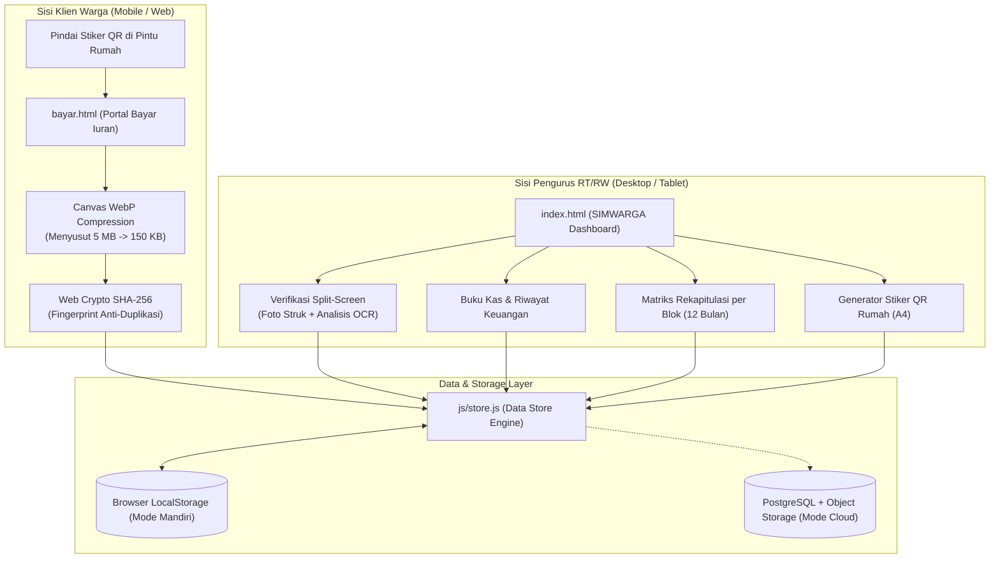
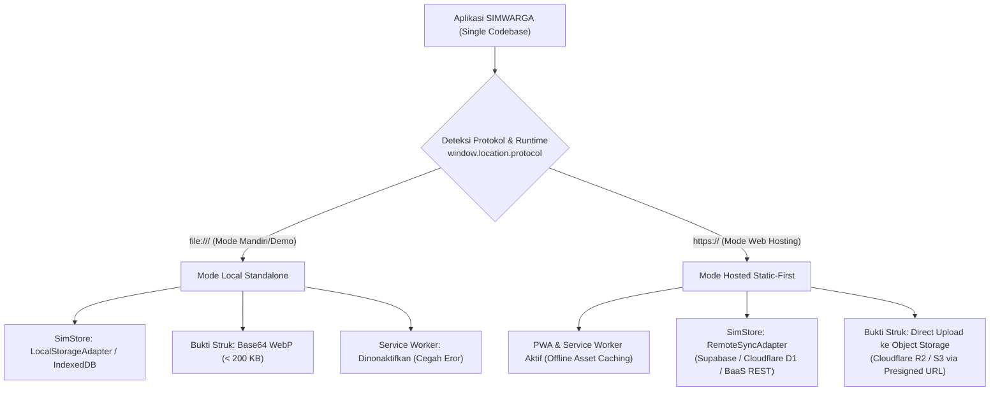

# Arsitektur Sistem & Strategi Multi-Tenancy

Dokumen ini menjelaskan rancangan arsitektur perangkat lunak SIMWARGA, model isolasi data antar-wilayah (*multi-tenancy*), serta rencana peningkatan skala (*scale-out*) untuk menangani jutaan pengguna.

---

## 1. Gambaran Umum Arsitektur (*High-Level Architecture*)

SIMWARGA mengadopsi arsitektur modular yang memisahkan antara **portal publik warga** (untuk pelaporan iuran via scan QR) dan **dasbor pengurus RT/RW** (untuk verifikasi, pembukuan kas, serta manajemen data kependudukan).



---

## 2. Strategi Multi-Tenancy Berbasis Wilayah

Sistem dirancang khusus untuk mengisolasi data secara ketat berdasarkan hierarki alamat fisik:

$$\text{Provinsi} \longrightarrow \text{Kota/Kabupaten} \longrightarrow \text{Kecamatan} \longrightarrow \text{Kelurahan} \longrightarrow \text{RW} \longrightarrow \text{RT} \longrightarrow \text{Nomor Blok} \longrightarrow \text{Nomor Rumah}$$

### Komposit Tenant Key (`tenant_id`)
Setiap data transaksi iuran dan master unit rumah diikat dengan identifier unik:
* **Format Kunci Tenant:** `KL-{KODE_KELURAHAN}-RW{NO_RW}-RT{NO_RT}`
* **Contoh:** `KL-SUKAMAJU-RW07-RT03`
* **Sub-Unit Identitas:** `BLOK-{NAMA_BLOK}-NO{NOMOR_RUMAH}` (contoh: `BLOK-A-NO14`)

### Keuntungan Pendekatan Ini:
1. **Isolasi Mutlak:** Pengurus RT 03 tidak akan pernah bisa mengakses bukti pembayaran, identitas warga, maupun saldo kas RT 04.
2. **Skalabilitas Sharding/Partitioning:** Saat dipindahkan ke server database (PostgreSQL), data dapat dipartisi berdasarkan `kelurahan_id` atau `tenant_id`, sehingga query agregasi kas hanya menyisir partisi lokal tanpa melambatkan wilayah lain.
3. **Penyimpanan Gambar Terstruktur:** Berkas bukti transfer disimpan di Object Storage dengan struktur folder hierarkis:
   ```text
   bucket/bukti-iuran/{kelurahan}/{rw}/{rt}/{periode}/{transaksi_id}.webp
   ```

---

## 3. Rencana Peningkatan Skala (*Scale-Out Strategy*)

Untuk mendukung penggunaan bersama oleh ribuan RT/RW dengan jutaan transaksi per bulan, aplikasi siap dimigrasikan dari mode *Local Web App* menuju *Cloud Multi-Tenant*:

```mermaid
flowchart LR
    Clients["Jutaan Warga & Pengurus RT"] --> Cloudflare["Cloudflare CDN & WAF<br/>(DDoS Protection & SSL)"]
    Cloudflare --> APIGateway["Load Balancer / API Gateway"]
    
    APIGateway --> DirectUpload["Presigned URL Upload<br/>(Upload Langsung ke Cloudflare R2 / S3)"]
    DirectUpload --> R2Storage[("Cloudflare R2 Storage<br/>(Penyimpanan Struk Transfer)") ]
    
    APIGateway --> AppCluster["Stateless Backend Cluster<br/>(Node.js / Go / Rust)"]
    AppCluster --> PgBouncer["PgBouncer Connection Pooling"]
    
    PgBouncer --> PostgresPrimary[("PostgreSQL Primary (Write)<br/>ACID & Row-Level Security (RLS)")]
    PostgresPrimary -. Streaming Replication .-> PostgresReplica[("PostgreSQL Read Replicas<br/>(Query Laporan & Dasbor)")]
```

| Tingkat Beban | Rekomendasi Infrastruktur | Karakteristik |
| :--- | :--- | :--- |
| **Tahap Standalone (Saat Ini)** | Peramban Lokal (`LocalStorage`) | Tanpa server, zero deployment cost, ideal untuk pengurus RT mandiri. |
| **Skala 1 Kecamatan (10.000 – 50.000 Warga)** | Managed PostgreSQL (Supabase / RDS) + Cloudflare R2 | RLS aktif per RT, gambar struk langsung ke S3 presigned URL. |
| **Skala Kota / Nasional (1.000.000+ Warga)** | Distributed PostgreSQL (Citus) + Read Replicas + Redis Cache | Tabel dipartisi per kelurahan, cache session di Redis, CDN global. |

---

## 4. Batasan Teknis & Prinsip Dual-Mode (*Local Standalone & Hosted Web*)

Untuk menjembatani kebutuhan penggunaan mandiri tanpa server (*zero-setup*) dan kebutuhan operasional multi-perangkat warga secara online, SIMWARGA menetapkan aturan arsitektur **Dual-Mode**:



### 4.1 Aturan Operasional Mode Local Standalone (`file:///`)
1. **Zero Runtime Dependency:** Aplikasi wajib dapat dibuka langsung via klik ganda `index.html` dan `bayar.html` tanpa instalasi Node.js, Python, atau web server lokal.
2. **Namespace Global Modular:** Dilarang menggunakan ES Module `import`/`export` lintas file untuk mencegah galat CORS (*Cross-Origin Resource Sharing*) pada protokol `file:///`. Semua modul terikat pada objek global terisolasi (`window.SimStore`, `window.AppState`).
3. **Penyimpanan Terisolasi Satu Perangkat:** Seluruh data master dan riwayat transaksi disimpan di `localStorage` peramban. Bukti struk disimpan sebagai string Base64 WebP berukuran terkompresi $\le 200\text{ KB}$.
4. **Pencegahan Eror Service Worker:** Pendaftaran *Service Worker* wajib diproteksi agar tidak dieksekusi pada `file:///` (`if ('serviceWorker' in navigator && window.location.protocol.startsWith('http'))`).

### 4.2 Aturan Operasional Mode Web Hosting (`https://`)
1. **Static-First Deployment (Jamstack/Edge):**
   * Seluruh frontend wajib dapat di-deploy sebagai berkas statis murni pada platform CDN/Edge gratis/hemat (Cloudflare Pages, Vercel, Netlify, GitHub Pages).
   * Tidak boleh ada ketergantungan pada backend monolitik (Node.js/PHP runtime) di sisi server penyaji berkas HTML/CSS/JS.
2. **Pola Abstraksi Penyimpanan (*Storage Adapter Pattern*):**
   * Antarmuka `SimStore` memisahkan *data access layer* ke dalam driver yang dapat diganti (*pluggable driver*):
     * `LocalStorageAdapter`: Driver bawaan untuk pengujian offline dan mode standalone.
     * `RemoteSyncAdapter`: Driver berbasis REST API / SDK BaaS (Supabase, Firebase, Cloudflare D1) untuk sinkronisasi data antar-perangkat warga dan pengurus.
3. **Penyimpanan Struk Skalabel (*Object Storage Direct Upload*):**
   * Di lingkungan web hosting, dilarang menyimpan string Base64 gambar ke dalam basis data utama.
   * Klien melakukan unggah langsung (*direct upload*) berkas biner WebP ke Object Storage (Cloudflare R2, AWS S3, atau Supabase Storage) via *Presigned URL*. Basis data hanya menyimpan tautan URL publik yang terlindungi.
4. **Konteks Aman Wajib (*Secure Context - HTTPS*):**
   * Hosting wajib mengaktifkan SSL/TLS (HTTPS) untuk membuka kemampuan penuh Web Crypto API (`crypto.subtle`), *Progressive Web App* (PWA), serta izin kamera WebRTC guna pemindaian QR Code instan di portal warga.
5. **Isolasi Multi-Tenancy pada Domain Bersama:**
   * Setiap permintaan data mutlak menyertakan kunci `tenant_id` (`KL-{KODE}-RW{NO}-RT{NO}`).
   * Subdomain atau parameter hash URL digunakan untuk menentukan tenant aktif secara dinamis (`https://simwarga.id/#/KL-SUKAMAJU-RW07-RT03`).


