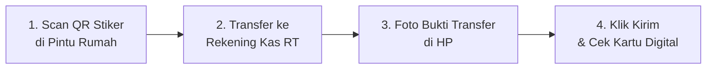

# 📖 Panduan Pengguna SIMWARGA (Buku Petunjuk Praktis)

Buku panduan ini disusun khusus untuk **Warga**, **Bendahara RT**, dan **Ketua/Sekretaris RT** agar dapat menggunakan aplikasi SIMWARGA dengan mudah, cepat, dan tanpa ribet.

---

## 🧭 Daftar Isi Panduan

1. [Cara Masuk (Login) & Hak Akses Berdasarkan Peran](#0-panduan-login--hak-akses-pengguna)
2. [Untuk Warga: Cara Konfirmasi Bayar Iuran via QR Stiker](#1-panduan-warga-cara-bayar-iuran-via-qr-stiker)
3. [Untuk Bendahara RT: Cara Verifikasi Bukti & Rekap Kas](#2-panduan-bendahara-rt-verifikasi-bukti--rekap-iuran)
4. [Untuk Pengurus RT: Cetak Stiker QR & Layanan Surat](#3-panduan-pengurus-rt-stiker-qr--layanan-surat)
5. [Tips Penting & Tanya Jawab Umum (FAQ)](#4-tanya-jawab-umum-faq)

---

## 0. Panduan Login & Hak Akses Pengguna

Aplikasi SIMWARGA dilengkapi sistem autentikasi modern dan aman untuk melindungi kerahasiaan data kependudukan warga serta transparansi pembukuan kas lingkungan.

### A. Tabel Akun Bawaan (Demo Siap Pakai)
Bagi pengguna yang ingin menguji aplikasi di **[https://agungtri.github.io/SIMWARGA/](https://agungtri.github.io/SIMWARGA/)**, tersedia tombol **"Akses Cepat Pengujian (Demo)"** di layar login yang dapat diklik langsung tanpa perlu mengetik manual:

| Peran (Role) | Username | Kata Sandi | Nama Pengguna | Menu yang Dapat Diakses |
| :--- | :--- | :--- | :--- | :--- |
| **Ketua RT (Admin)** | `admin` | `admin123` | H. Bambang Sudrajat | **Akses Penuh:** Dashboard, Data Warga & KK, Kas & Iuran, Layanan Surat, Tamu, Keamanan & Ronda, Pengaturan RT & Manajemen User |
| **Bendahara RT** | `bendahara` | `bendahara123` | Hj. Siti Aminah | Dashboard, Buku Kas Umum, Verifikasi Bukti Bayar QR, Cetak Stiker QR, Laporan Rekapitulasi per Blok |
| **Sekretaris RT** | `sekretaris` | `sekretaris123` | Hendra Wijaya | Dashboard, Data Induk Warga & KK, Layanan Surat Pengantar RT/RW, Buku Tamu |
| **Petugas Keamanan** | `keamanan` | `keamanan123` | Pak Joko Sutrisno | Dashboard, Buku Tamu & Rumah Kontrakan, Jadwal Ronda Siskamling & Buku Patroli |
| **Warga Lingkungan** | `warga` | `warga123` | Budi Santoso | Dashboard Transparansi Kas RT, Status Kartu Iuran Rumah, Pengajuan Surat, dan Akses Portal Bayar QR |

### B. Cara Masuk ke Aplikasi
1. Buka tautan SIMWARGA di browser laptop atau HP Anda.
2. Di layar login, masukkan **Username** dan **Kata Sandi**.
3. Jika ingin login cepat untuk demo, cukup ketuk tombol peran yang diinginkan pada kotak **"Akses Cepat Pengujian (Demo)"**.
4. Centang **"Ingat sesi di perangkat ini"** jika Anda menggunakan perangkat pribadi.
5. Klik **"Masuk ke Sistem"**.

### C. Cara Keluar (Logout)
* Klik ikon keluar (**Logout**) di pojok kanan atas layar atau di bagian bawah bilah navigasi samping (sidebar).
* Konfirmasikan keluar untuk mengakhiri sesi kerja Anda.

---

## 1. Panduan Warga: Cara Bayar Iuran via QR Stiker

Sebagai warga, Anda **tidak perlu mengunduh aplikasi** di Play Store atau membuat akun/kata sandi yang rumit. Cukup gunakan kamera HP Anda.

### Langkah Demi Langkah:

#### Langkah 1: Pindai Stiker QR di Rumah Anda
* Buka aplikasi **Kamera** di HP Anda (atau pemindai QR bawaan).
* Arahkan kamera ke stiker QR yang tertempel di pintu/pagar rumah Anda.
* Ketuk tautan yang muncul di layar. Halaman konfirmasi pembayaran akan otomatis terbuka di browser HP Anda.

> [!TIP]
> **Otomatis Mengenali Rumah Anda:** Sistem langsung menampilkan Blok, Nomor Rumah, dan Nama Anda tanpa perlu login!

#### Langkah 2: Salin Rekening atau Pindai QRIS Kas RT
* Pada layar HP, Anda dapat memilih metode pembayaran:
  * **Opsi A (Transfer Bank):** Ketuk tombol **"Salin"** untuk menyalin nomor rekening (misal: BCA `5420-192-881`).
  * **Opsi B (QRIS Kas RT):** Pindai barcode QRIS langsung menggunakan aplikasi e-wallet apa saja (*GoPay, OVO, Dana, ShopeePay*) atau mobile banking manapun tanpa biaya admin transfer antarbank.
* Lakukan pembayaran sesuai tarif iuran bulanan (contoh: Rp 50.000).
* Simpan bukti transfer atau ambil tangkapan layar (*screenshot*).

#### Langkah 3: Unggah Foto Bukti Transfer
* Kembali ke halaman peramban HP Anda.
* Pilih **Jumlah Bulan / Periode Pembayaran** yang ingin dibayar:
  * Anda bisa memilih 1 Bulan, 2 Bulan, 3 Bulan (Triwulan), 6 Bulan (Semester), atau 12 Bulan (1 Tahun penuh).
  * Sistem otomatis menghitung total nominal wajib (contoh: 3 bulan = Rp 150.000).
* Ketuk kotak **"Ambil Foto atau Pilih Gambar"** lalu pilih foto struk transfer yang baru saja Anda simpan.
* Masukkan nomor referensi bank (jika tertera pada struk) untuk keamanan verifikasi.
* *(Foto otomatis dikompresi menjadi format WebP sangat ringan sehingga kuota internet Anda tetap hemat).*

#### Langkah 4: Kirim Konfirmasi & Notifikasi WhatsApp
* Ketuk tombol biru besar **"Kirim Konfirmasi Pembayaran"**.
* Selesai! Bukti Anda langsung terkirim ke sistem bendahara RT.
* **Opsional:** Ketuk tombol hijau **"Kirim Konfirmasi ke WhatsApp Bendahara"** jika ingin memberi tahu bendahara secara instan.
* Anda bisa langsung memeriksa kotak **Kartu Iuran Digital 2026** di bagian bawah layar untuk melihat riwayat pembayaran rumah Anda sepanjang tahun.

---

## 2. Panduan Bendahara RT: Verifikasi Bukti & Rekap Iuran

Tugas bendahara menjadi jauh lebih ringan karena tidak perlu lagi mencocokkan mutasi bank baris demi baris secara manual di buku tulis.

### A. Cara Memverifikasi Bukti Masuk
1. Buka aplikasi di HP atau laptop pengurus.
2. Klik menu **"Kas & Iuran Warga"** $\rightarrow$ klik sub-tab **"Verifikasi Bukti QR"**.
3. **Cek Sinkronisasi:** Tekan tombol **"Sinkronkan Data"** di kanan atas tabel untuk memastikan seluruh kiriman bukti warga terbaru sudah masuk.
4. **Verifikasi Cepat Massal (*Batch Approval*):**
   * Jika terdapat banyak bukti yang berstatus hijau (*LULUS OTOMATIS*), Anda dapat langsung menekan tombol **"✓ Setujui Semua yang Lulus Otomatis"**. Seluruh bukti valid akan disetujui sekaligus.
5. **Verifikasi Satuan (Tinjau Layar Belah):**
   * Klik tombol **"Tinjau"** pada baris bukti yang ingin diperiksa:
     * **Foto Struk Jelas:** Periksa struk transfer di sisi kiri.
     * **Rekomendasi Cerdas:** Cek kesesuaian nominal dan periode bulan di sisi kanan.
   * **Jika Sah:** Klik tombol hijau **"✓ Setujui & Catat ke Kas"**. Anda juga bisa menekan tombol **"Kirim Kuitansi via WA"** untuk mengirim tanda terima resmi ke HP warga.
   * **Jika Tidak Sah:** Klik tombol merah **"Tolak Bukti"**, masukkan alasannya, dan kirimkan notifikasi penolakan ke WA warga agar warga dapat mengirimkan bukti yang benar.
6. **Jika Salah Klik (*Undo / Rollback*):**
   * Jika bendahara tidak sengaja menyetujui bukti yang salah, cukup klik tombol **"Batalkan"** pada riwayat bukti. Sistem otomatis membatalkan mutasi kas dan mengembalikan status iuran.

> [!NOTE]
> **Otomatis Masuk Buku Kas:** Begitu Anda menekan tombol setujui, uang iuran tersebut **langsung otomatis masuk ke saldo kas RT** sebagai pemasukan tanpa perlu dicatat manual lagi! Matriks 12 bulan juga langsung otomatis mencentang lunas seluruh bulan yang dibayar.

### B. Cara Melihat Laporan Siapa yang Sudah/Belum Bayar
1. Pada menu **Kas & Iuran Warga**, klik sub-tab **"Laporan Iuran per Blok"**.
2. Anda akan melihat ringkasan:
   * Berapa persen warga yang sudah lunas bulan ini.
   * Jumlah rumah yang sudah bayar vs yang masih menunggak.
3. Di tabel matriks 12 bulan:
   * Tanda centang hijau (`✓`) = **Sudah Lunas**.
   * Tanda strip (`-`) = **Belum Membayar**.
4. **Ingin Mencetak Laporan?** Klik tombol **"🖨️ Cetak Rekap (A4)"** untuk mencetak laporan resmi format mendatar (*landscape*) lengkap dengan tempat tanda tangan Ketua RT dan Bendahara.
5. **Ingin Membuka di Excel?** Klik tombol **"📥 Export CSV"**.

### C. Cara Mencatat Iuran Tunai Langsung (*Direct Cash Pay*)
Bagi warga lansia atau warga yang menyerahkan uang tunai fisik langsung ke bendahara tanpa melalui aplikasi:
1. Buka menu **"Kas & Iuran Warga"** $\rightarrow$ klik tombol **"+ Terima Iuran Tunai"**.
2. Pilih nama unit warga (misal: *Blok A No. 14 - Hendra Wijaya*).
3. Pilih rentang bulan yang dibayarkan (bisa 1 bulan atau multi-bulan).
4. Klik **"Simpan & Bukukan ke Kas"**:
   * Uang tunai seketika tercatat sebagai pemasukan kas RT.
   * Status kartu iuran rumah tersebut langsung berstatus **LUNAS**.
5. Klik **"Kirim Kuitansi WhatsApp"** untuk mengirim tanda terima digital kepada warga bersangkutan sebagai bukti pembayaran yang sah.

### D. Cara Memeriksa Kantong Kas (Kas Bank vs Kas Tunai Fisik)
Pada sub-tab **"Buku Kas Umum"**, bendahara dapat melihat 2 kantong saldo terpisah:
* **Kas di Bank (BCA):** Saldo penerimaan transfer warga dan QRIS dikurangi pengeluaran operasional non-tunai. Dapat dicocokkan langsung dengan rekening koran/mutasi m-banking.
* **Kas di Tangan (Tunai):** Saldo fisik uang kertas/koin yang dipegang bendahara dari penerimaan iuran tunai langsung.
* **Total Saldo Kas:** Akumulasi total kekayaan likuid RT yang siap dilaporkan saat rapat pertanggungjawaban warga.

---

## 3. Panduan Pengurus RT: Stiker QR & Layanan Surat

### A. Cara Mencetak Stiker QR Rumah (Untuk Ditempel ke Pintu Warga)
1. Buka menu **"Kas & Iuran Warga"** $\rightarrow$ pilih **"Cetak Stiker QR Rumah"**.
2. Anda bisa memilih blok tertentu (misal: *Blok A Saja*).
3. Anda akan melihat kartu stiker untuk setiap rumah yang sudah dilengkapi QR Code siap pakai.
4. Klik tombol **"🖨️ Cetak Stiker A4"**.
5. Gunakan kertas stiker HVS atau kertas label, cetak dengan printer biasa, lalu gunting dan tempelkan di pagar/pintu rumah warga.

### B. Cara Membuat Surat Pengantar RT/RW (Siap Cetak PDF)
1. Klik menu **"Layanan Surat"** di menu samping.
2. Klik tombol **"+ Buat Surat Pengantar"**.
3. Pilih nama warga dari daftar (NIK dan alamat domisili akan otomatis terisi).
4. Masukkan keperluan surat (misal: *Pengurusan SKCK*, *KTP Baru*, *Keterangan Domisili*).
5. Klik **"Buat & Preview Surat"**.
6. Format surat resmi A4 lengkap dengan kop surat RT/RW dan tanda tangan akan langsung muncul di layar. Klik **"Cetak / Download PDF"**.

### C. Cara Menambah / Mengedit Data Warga
1. Klik menu **"Data Warga & KK"**.
2. Anda dapat melihat daftar semua warga atau mengelompokkannya per **Kartu Keluarga (KK)**.
3. Untuk menambah warga baru, klik tombol **"+ Tambah Warga Baru"**, isi NIK, nama lengkap, pekerjaan, status keluarga, lalu simpan.

---

## 4. Tanya Jawab Umum (FAQ)

### Q1: Apakah aplikasi ini membutuhkan koneksi internet?
> **Jawab:** SIMWARGA mendukung **Dual-Mode**:
> 1. **Mode Standalone (Luring / file:///):** Aplikasi dapat dibuka langsung tanpa server/internet untuk keperluan pencatatan mandiri bendahara.
> 2. **Mode Hosted Web (Online / PWA):** Ketika di-deploy ke hosting web statis (Cloudflare Pages / GitHub Pages), warga dapat mengakses portal bayar dari HP di mana saja. Data struk otomatis disinkronkan ke server cloud RT, dan pengurus dapat menginstal aplikasi ke layar utama HP (*Add to Home Screen*) dengan kemampuan kerja saat jaringan terputus (*offline-first*).

### Q2: Bagaimana jika warga salah mengirim struk atau gambarnya buram?
> **Jawab:** Pada saat bendahara meninjau bukti bayar, klik tombol merah **"✕ Tolak Bukti"**, lalu ketikkan alasannya (contoh: *"Gambar buram, mohon foto ulang"*). Warga dapat mengunggah kembali foto struk yang benar.

### Q3: Apakah bukti transfer yang sama bisa dipakai dua kali oleh warga nakal?
> **Jawab:** **Tidak bisa.** Sistem memiliki pengaman digital (*SHA-256 Hashing*). Jika gambar struk yang sama persis diunggah ulang, sistem akan otomatis menolak dan memunculkan peringatan bahwa bukti tersebut sudah pernah digunakan.

### Q4: Di mana data warga dan kas disimpan? Apakah aman jika komputer mati?
> **Jawab:** Data tersimpan aman di memori peramban (*LocalStorage*) komputer Anda. Namun, untuk mencegah data terhapus jika komputer di-install ulang:
> * Buka menu **Pengaturan RT & Data**.
> * Klik tombol hitam **"Download Backup File (JSON)"** sebulan sekali dan simpan di flashdisk atau Google Drive.
> * Jika berganti laptop, cukup klik **"Pulihkan dari File Backup"** untuk mengembalikan seluruh data dalam 1 detik.

---

*Buku panduan ini diperbarui otomatis sesuai versi sistem SIMWARGA terbaru.*

