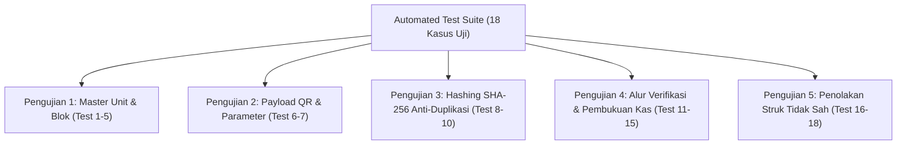

# Spesifikasi & Panduan Pengujian Teknis

Dokumen ini menjelaskan kerangka kerja pengujian (*test framework*), rincian 18 kasus uji otomatis (*automated test cases*), serta prosedur verifikasi berkala untuk menjamin stabilitas fungsional sistem SIMWARGA.

---

## 1. Arsitektur Berkas Penguji (`test_runner.html`)

Sistem pengujian dibangun tanpa ketergantungan pada pustaka pihak ketiga (*zero-dependency test harness*). Berkas penguji mandiri [test_runner.html](../test_runner.html) dapat dijalankan langsung di peramban atau melalui mode *headless* di terminal CI/CD.

```text
netijen/
├── test_runner.html     # Runner otomasi pengujian unit & integrasi
└── js/
    └── store.js         # Modul yang diuji
```

---

## 2. Rincian Kasus Uji Otomatis (18 Kasus Uji)



### Skenario 1: Integritas Struktur Data Master Unit Rumah
* **Test 1:** Memastikan `SimStore.getUnitRumah()` mengembalikan larik (*array*) minimal 7 unit rumah default.
* **Test 2:** Memastikan unit dengan kunci `UNIT-A02` berhasil ditemukan.
* **Test 3:** Memastikan atribut `blok === 'Blok A'` dan `nomorRumah === '14'`.
* **Test 4:** Memastikan nama penghuni sesuai (`'Hendra Wijaya'`).
* **Test 5:** Memastikan tarif iuran standar terdefinisi sebesar Rp 50.000.

### Skenario 2: Payload QR Stiker & Resolusi Parameter
* **Test 6:** Memvalidasi format URL tujuan stiker QR: `bayar.html?unit=UNIT-A02`.
* **Test 7:** Menguji simulasi parsing parameter kueri URL di sisi portal warga untuk memastikan identitas rumah terpetakan tanpa proses login manual.

### Skenario 3: Hashing Kriptografis Anti-Duplikasi
* **Test 8:** Memverifikasi fungsi `crypto.subtle.digest('SHA-256')` menghasilkan *fingerprint* heksadesimal tepat 64 karakter.
* **Test 9:** Mendaftarkan berkas dengan nilai hash uji dan memastikan sistem mendeteksi keberadaannya.
* **Test 10:** Menguji logika pencegahan duplikasi agar transaksi dengan hash identik ditolak oleh sistem.

### Skenario 4: Alur Verifikasi & Pembukuan Kas Otomatis
* **Test 11:** Memastikan bukti bayar yang baru diunggah masuk dengan status `'Menunggu Verifikasi'`.
* **Test 12:** Mengeksekusi verifikasi bendahara dan memastikan status berubah menjadi `'Terverifikasi'`.
* **Test 13:** Memverifikasi bahwa jumlah baris transaksi Buku Kas RT (`SimStore.getTransaksi()`) bertambah tepat 1 baris.
* **Test 14:** Memastikan nominal kas masuk sesuai dengan nilai bukti transfer (Rp 50.000).
* **Test 15:** Memastikan jenis transaksi tercatat sebagai `'Pemasukan'` dengan kategori `'Iuran Bulanan'`.

### Skenario 5: Alur Penolakan Struk Tidak Sah
* **Test 16:** Memastikan bukti transfer yang bermasalah (nominal kurang) berhasil diubah menjadi status `'Ditolak'`.
* **Test 17:** Memastikan catatan alasan penolakan bendahara tersimpan pada entitas transaksi.
* **Test 18:** Memverifikasi bahwa transaksi yang ditolak **tidak menambah mutasi maupun saldo** ke dalam Buku Kas RT.

---

## 3. Cara Menjalankan Pengujian

### Metode A: Melalui Peramban Grafis (Visual)
1. Buka berkas [test_runner.html](../test_runner.html) dengan cara klik dua kali (*double click*) di File Explorer.
2. Seluruh indikator centang hijau `✓ PASS` untuk ke-18 pengujian dan kartu ringkasan hasil akan ditampilkan seketika.

### Metode B: Melalui Terminal Headless (PowerShell)
Gunakan Google Chrome atau Microsoft Edge dalam mode *headless*:

```powershell
# Eksekusi via Google Chrome Headless
& "C:\Program Files\Google\Chrome\Application\chrome.exe" --headless=new --disable-gpu --allow-file-access-from-files --virtual-time-budget=5000 --dump-dom "file:///c:/Users/Agung/netijen/test_runner.html"

# Eksekusi via Microsoft Edge Headless
& "C:\Program Files (x86)\Microsoft\Edge\Application\msedge.exe" --headless=new --disable-gpu --allow-file-access-from-files --virtual-time-budget=5000 --dump-dom "file:///c:/Users/Agung/netijen/test_runner.html"
```
Output terminal akan menampilkan elemen DOM:
```html
<div id="summary" class="summary-pass">
  <strong>🎉 SEMUA PENGUJIAN TAHAP 1 BERHASIL!</strong><br>
  Total Pengujian: 18 | Lulus: 18 | Gagal: 0<br>
  Status Tahap 1: <strong>VALID & SIAP DIGUNAKAN</strong>
</div>
```

