# Spesifikasi & Panduan Pengujian Teknis

Dokumen ini menjelaskan kerangka kerja pengujian (*test framework*), rincian seluruh 80 kasus uji otomatis (*automated test cases*) pada 21 modul uji fungsional, uji ketahanan (*hardness test*), dan adaptor penyimpanan hosted web, serta prosedur verifikasi berkala untuk menjamin stabilitas, keamanan, dan keandalan sistem SIMWARGA.

---

## 1. Arsitektur Berkas Penguji (`test_runner.html`)

Sistem pengujian dibangun tanpa ketergantungan pada pustaka eksternal (*zero-dependency test harness*). Berkas penguji mandiri [test_runner.html](../test_runner.html) dapat dijalankan langsung di peramban secara lokal (*file:///*) atau melalui mode *headless* di terminal otomatisasi CI/CD.

```text
netijen/
├── test_runner.html     # Runner otomasi pengujian fungsional, hardness & hosted web (80 test)
└── js/
    ├── store.js         # Modul basis data SimStore (Safe parse, Storage Adapter, UUID, CRUD)
    └── app.js           # Logika aplikasi, akuntansi jurnal ganda, state machine
```

---

## 2. Peta Seluruh Skenario & Kasus Uji Otomatis (80 Kasus Uji)

```mermaid
flowchart TD
    Suite["Automated Test Suite (80 Kasus Uji / 21 Seksi)"]
    
    Suite --> Core["Fungsionalitas Inti (Test 1 - 49)"]
    Core --> F1["P1-P5: Master Data, QR, SHA-256, Verifikasi, Penolakan (Test 1-18)"]
    Core --> F2["P6-P9: Multi-Bulan, Rollback, Double-Entry CoA, Kas Tunai (Test 19-29)"]
    Core --> F3["P10-P12: Warga CRUD, Surat, Tamu, Ronda, Pos Kamling (Test 30-41)"]
    Core --> F4["P13-P14: Backup/Restore JSON & Validasi Cerdas/Matriks (Test 42-49)"]
    
    Suite --> Hardness["Uji Ketahanan / Hardness Suite (Test 50 - 74)"]
    Hardness --> H1["P15: Input Ekstrem, XSS, Unicode Emoji, Escape (Test 50-53)"]
    Hardness --> H2["P16: Batas Nilai Rp 0 & Rp 1 Miliar, Invarian Saldo (Test 54-57)"]
    Hardness --> H3["P17: Volume Tinggi & Zero Collision Burst 100/50/50 (Test 58-60)"]
    Hardness --> H4["P18: Kalender & Rollover Lintas Tahun (Test 61-63)"]
    Hardness --> H5["P19: State Machine Lifecycle & Anti-Duplikasi Ref Bank (Test 64-71)"]
    Hardness --> H6["P20: Kerusakan Storage & Toleransi Gangguan / Fault Tolerance (Test 72-74)"]

    Suite --> Hosted["Uji Hosted Web & Storage Adapter (Test 75 - 80)"]
    Hosted --> A1["P21: Deteksi Runtime, Cloud Config, Tenant ID, Offline Queue (Test 75-80)"]
```



---

## 3. Rincian Kasus Uji per Bagian

### Bagian 1: Master Unit & Struktur Data (Test 1 - 5)
* **Test 1:** `SimStore.getUnitRumah()` mengembalikan minimal 7 unit rumah bawaan.
* **Test 2:** Unit `UNIT-A02` terdaftar di database.
* **Test 3:** Atribut blok dan nomor rumah terpetakan presisi (`Blok A No. 14`).
* **Test 4:** Nama pemilik/penghuni terverifikasi (`Hendra Wijaya`).
* **Test 5:** Tarif iuran standar terkonfigurasi Rp 50.000.

### Bagian 2: Resolusi Parameter URL QR Stiker (Test 6 - 7)
* **Test 6:** URL payload QR stiker valid mengarah ke `bayar.html?unit=UNIT-A02`.
* **Test 7:** Parsing URLSearchParams mengenali data unit warga tanpa memerlukan sesi autentikasi.

### Bagian 3: Hashing Kriptografis SHA-256 Anti-Duplikasi (Test 8 - 10)
* **Test 8:** `crypto.subtle.digest('SHA-256')` menghasilkan sidik jari heksadesimal 64 karakter.
* **Test 9:** Deteksi hash struk gambar yang telah terdaftar di database.
* **Test 10:** Penolakan unggahan ulang struk dengan hash identik (mencegah double claim).

### Bagian 4: Alur Verifikasi & Pembukuan Kas Otomatis (Test 11 - 15)
* **Test 11:** Struk yang diunggah warga masuk dalam status `Menunggu Verifikasi`.
* **Test 12:** Verifikasi oleh pengurus mengubah status menjadi `Terverifikasi`.
* **Test 13:** Mutasi Buku Kas bertambah tepat 1 baris.
* **Test 14:** Nilai nominal kas masuk sesuai dengan struk transfer (Rp 50.000).
* **Test 15:** Tipe mutasi tercatat `Pemasukan` dengan kategori `Iuran Bulanan`.

### Bagian 5: Penolakan Struk Tidak Sah (Test 16 - 18)
* **Test 16:** Struk bermasalah berhasil ditandai status `Ditolak`.
* **Test 17:** Alasan penolakan pengurus tercatat di log riwayat.
* **Test 18:** Struk yang ditolak dipastikan **tidak masuk** ke mutasi Buku Kas RT.

### Bagian 6: Pembayaran Multi-Bulan (Test 19 - 20)
* **Test 19:** Sistem mendeteksi pemilihan beberapa periode bulan sekaligus (`2026-10, 2026-11, 2026-12`).
* **Test 20:** Perhitungan pelunasan mencakup keseluruhan bulan yang dipilih secara akurat.

### Bagian 7: Pembatalan Verifikasi (Rollback) & Koreksi Kas (Test 21 - 23)
* **Test 21:** Eksekusi rollback menghapus mutasi pemasukan kas terkait.
* **Test 22:** Status bukti bayar dipulihkan kembali ke `Menunggu Verifikasi`.
* **Test 23:** Relasi kunci `transaksiId` dinetralkan menjadi `null`.

### Bagian 8: Jurnal Berpasangan (Double-Entry CoA) (Test 24 - 26)
* **Test 24:** Pencatatan debit rekening bank menggunakan kode akun `1-102` (Kas di Bank BCA).
* **Test 25:** Pencatatan kredit pendapatan menggunakan kode akun `4-101` (Pendapatan Iuran).
* **Test 26:** Kanal pembayaran perbankan/QRIS teridentifikasi dengan tepat.

### Bagian 9: Penerimaan Iuran Tunai Langsung & Kuitansi (Test 27 - 29)
* **Test 27:** Pencatatan debit kas tunai menggunakan kode akun `1-101` (Kas Tunai di Tangan).
* **Test 28:** Iuran tunai yang diterima langsung berstatus `Terverifikasi` seketika.
* **Test 29:** Bukti bayar tunai tertaut langsung dengan mutasi kas dan nomor kuitansi otomatis.

### Bagian 10: Manajemen Data Kependudukan (Warga CRUD) (Test 30 - 34)
* **Test 30:** Data warga awal memuat 10 warga default.
* **Test 31:** Penambahan warga baru dengan validasi field lengkap.
* **Test 32:** Pembaruan nomor telepon dan status warga.
* **Test 33:** Validasi NIK wajib 16 digit angka.
* **Test 34:** Penghapusan data warga berhasil membersihkan entitas.

### Bagian 11: Pelayanan Surat & Registrasi Tamu (Test 35 - 39)
* **Test 35:** Penambahan permohonan surat pengantar berstatus `Menunggu Persetujuan`.
* **Test 36:** Persetujuan surat menghasilkan nomor registrasi resmi.
* **Test 37:** Penghapusan surat pengantar berjalan bersih.
* **Test 38:** Pencatatan tamu wajib lapor 1x24 jam berstatus `Berkunjung`.
* **Test 39:** Registrasi kepulangan tamu mengubah status menjadi `Selesai / Pulang`.

### Bagian 12: Keamanan Lingkungan & Jadwal Ronda (Test 40 - 41)
* **Test 40:** Pelaporan kejadian keamanan pos kamling tersimpan dengan identitas `LK-*`.
* **Test 41:** Penghapusan laporan keamanan pos kamling berhasil.

### Bagian 13: Integritas Cadangan Sistem (Backup & Restore JSON) (Test 42 - 44)
* **Test 42:** Ekspor cadangan sistem menghasilkan string JSON terstruktur.
* **Test 43:** Berkas cadangan memuat keseluruhan 9 entitas utama sistem.
* **Test 44:** Pemulihan (*restore*) berkas cadangan JSON berhasil 100%.

### Bagian 14: Mesin Validasi Cerdas & Matriks Rekapitulasi (Test 45 - 49)
* **Test 45:** Nominal tepat tarif direkomendasikan `LULUS OTOMATIS`.
* **Test 46:** Nominal kelipatan multi-bulan direkomendasikan `LULUS OTOMATIS`.
* **Test 47:** Nominal kurang dari tarif diberi rekomendasi `PERLU CEK MANUAL`.
* **Test 48:** Matriks rekapitulasi mengenali status lunas unit per bulan.
* **Test 49:** Matriks menandai bulan yang belum dibayar sebagai tunggakan.

---

### Bagian 15: Uji Hardness - Ketahanan Input Ekstrem & Sanitasi String (Test 50 - 53)
* **Test 50 (XSS & Script Injection):** Input teks yang mengandung payload `<script>alert('xss')<\/script>` tersimpan murni sebagai string tanpa terjadi eksekusi script liar.
* **Test 51 (Unicode, Aksara Asing & Multi-Byte Emoji):** Karakter multibyte seperti aksara Arab, Mandarin, Jepang, aksen Latin (`Jöhñ Döe`), serta bendera emoji (`🇮🇩 🌟`) tersimpan dan terbaca kembali utuh tanpa de-encoding error.
* **Test 52 (Escape Characters):** String yang memuat petik tunggal (`'`), petik ganda (`"`), backslash (`\`), pemisah baris (`\n`, `\r`), dan tabulasi (`\t`) tersimpan dan lolos serialisasi JSON tanpa merusak struktur parsing.
* **Test 53 (Format NIK/KK Fleksibel):** Karakter pemisah spasi atau tanda minus pada nomor NIK dan KK tersimpan aman tanpa memicu crash.

### Bagian 16: Uji Hardness - Batas Nilai & Presisi Matematika Kas (Test 54 - 57)
* **Test 54 (Batas Bawah Rp 0):** Mutasi transaksi nominal batas nol (Rp 0) dihitung secara matematis tanpa memicu nilai `NaN` atau `Infinity`.
* **Test 55 (Batas Atas Rp 1 Miliar):** Transaksi berskala besar (Rp 1.000.000.000) terhitung akurat hingga digit satuan tanpa kehilangan presisi floating point.
* **Test 56 (Invarian Kantong Kas):** Saldo total kas selalu identik dengan penjumlahan Kas di Bank BCA ditambah Kas Tunai di Tangan (`Total === Bank + Tunai`).
* **Test 57 (Invarian Mutasi Kas):** Saldo akhir kas selalu identik secara matematis dengan rumus pembukuan: `Saldo Akhir === Saldo Awal + Total Pemasukan - Total Pengeluaran`.

### Bagian 17: Uji Hardness - Volume Tinggi & Anti-Tabrakan Kunci / Concurrent Burst (Test 58 - 60)
* **Test 58 (Burst 100 Transaksi):** Pembuatan 100 transaksi secara beruntun dalam siklus mikrodetik yang sama menghasilkan 100 ID unik tanpa tabrakan kunci (*zero key collision*).
* **Test 59 (Burst 50 Bukti Bayar):** Pembuatan 50 bukti bayar serentak menghasilkan 50 ID unik dengan entropi tinggi (`Math.random().toString(36)`).
* **Test 60 (Burst 50 Warga):** Penambahan 50 entitas warga secara cepat menghasilkan 50 identitas unik dan terhapus secara bersih.

### Bagian 18: Uji Hardness - Kalender & Rollover Lintas Tahun (Test 61 - 63)
* **Test 61 (Pelunasan Multi-Bulan Lintas Tahun):** Pembayaran paket akhir tahun (November 2026 s/d Februari 2027: `2026-11, 2026-12, 2027-01, 2027-02`) terdeteksi lunas secara akurat pada kedua tahun kalender.
* **Test 62 (Integritas Format Kalender):** Rentang bulan tidak menghasilkan bulan invalid (seperti `2026-13`), melainkan melakukan rollover benar ke `2027-01`.
* **Test 63 (Isolasi Filter Periode):** Bulan di luar rentang paket multi-bulan (misal `2026-09`) tetap berstatus belum bayar tanpa terjadi kebocoran status lunas.

### Bagian 19: Uji Hardness - State Machine & Integritas Referensial (Test 64 - 71)
* **Test 64 (Anti-Duplikasi Nomor Referensi Bank):** Sistem mendeteksi nomor referensi mutasi bank yang sudah terdaftar guna mencegah klaim ganda struk transfer antarwarga.
* **Test 65 (Penerimaan Referensi Unik):** Nomor referensi mutasi bank baru yang belum pernah digunakan diterima dengan status valid.
* **Test 66 (Rollback Idempoten):** Operasi pembatalan verifikasi pada bukti bayar yang belum berstatus terverifikasi bersifat idempoten tanpa memicu galat dan tanpa menghapus mutasi transaksi lain secara keliru.
* **Test 67 (Penanganan ID Fiktif):** Perintah penghapusan transaksi dengan ID non-existent ditangani dengan aman tanpa memicu uncaught exception.
* **Test 68 (Siklus Hidup Bukti - Transisi Ditolak):** Status bukti bayar dapat beralih dari `Menunggu Verifikasi` ke `Ditolak`.
* **Test 69 (Siklus Hidup Bukti - Transisi Re-evaluasi):** Bukti bayar yang ditolak dapat dikembalikan ke `Menunggu Verifikasi` saat warga memberikan konfirmasi tambahan.
* **Test 70 (Siklus Hidup Bukti - Transisi Terverifikasi):** Persetujuan bukti bayar otomatis membukukan kas masuk dan menautkan `transaksiId`.
* **Test 71 (Siklus Hidup Bukti - Transisi Rollback Terverifikasi):** Pembatalan verifikasi menarik mutasi kas dan memulihkan saldo kas persis seperti semula.

### Bagian 20: Uji Hardness - Kerusakan Storage & Toleransi Gangguan / Fault Tolerance (Test 72 - 74)
* **Test 72 (Penanganan String Korup di LocalStorage):** Fungsi `SimStore._safeParse` mendeteksi data JSON malformed/terpotong di LocalStorage dan mengembalikan nilai *fallback default* tanpa menyebabkan peramban macet (*freeze* atau *crash*).
* **Test 73 (Penolakan Arsip Cadangan Rusak):** Fungsi `SimStore.importBackupJSON` memverifikasi struktur berkas dan menolak arsip rusak (string kosong, non-JSON, tipe data angka primitif, objek tanpa entitas).
* **Test 74 (Proteksi Data Aktif):** Seluruh data aktif di sistem terbukti 100% utuh dan tidak terhapus saat terjadi kegagalan pemulihan berkas cadangan rusak.

### Bagian 21: Uji Adaptor Penyimpanan & Hosted Web Dual-Mode (Test 75 - 80)
* **Test 75 (Deteksi Protokol Runtime):** Fungsi `SimStore.isHostedMode()` mengembalikan nilai boolean valid (`true` pada HTTP/HTTPS, `false` pada `file:///`).
* **Test 76 (Struktur Default Konfigurasi Cloud):** Fungsi `SimStore.getCloudConfig()` memuat struktur standar (`enabled`, `provider`, `tenantId`, `endpointUrl`).
* **Test 77 (Pembaruan Konfigurasi Cloud Adapter):** Fungsi `SimStore.saveCloudConfig()` menyimpan konfigurasi baru secara aman dan persisten.
* **Test 78 (Isolasi Tenant ID Wilayah):** Fungsi `SimStore.getTenantId()` memetakan identitas komposit wilayah (`KL-SUKAMAJU-RW07-RT03`) untuk isolasi multi-tenancy.
* **Test 79 (Antrean Mutasi Luring / Offline Queue):** Sistem menampung transaksi mutasi saat offline (`enqueueOffline`) dan mengosongkan antrean saat proses sinkronisasi berhasil.
* **Test 80 (Pembersihan Antrean Luring):** Fungsi `SimStore.clearOfflineQueue()` mengosongkan antrean mutasi luring dengan bersih tanpa sisa residu data.

---

## 4. Cara Menjalankan Pengujian

### Metode A: Melalui Peramban Grafis (Visual)
1. Buka berkas [test_runner.html](../test_runner.html) dengan cara klik dua kali (*double click*) di File Explorer.
2. Seluruh indikator centang hijau `✓ PASS` untuk ke-80 pengujian dan kartu ringkasan hasil akan ditampilkan seketika.

### Metode B: Melalui Terminal Headless (PowerShell)
Gunakan Google Chrome atau Microsoft Edge dalam mode *headless*:

```powershell
# Eksekusi via Microsoft Edge Headless
Start-Process "C:\Program Files (x86)\Microsoft\Edge\Application\msedge.exe" -ArgumentList "--headless=new", "--dump-dom", "--disable-gpu", "file:///c:/Users/Agung/netijen/test_runner.html" -RedirectStandardOutput "test_out.html" -Wait; Get-Content "test_out.html" | Select-String "summary-pass|summary-fail|Total Pengujian"; Remove-Item "test_out.html"
```

Output terminal:
```html
<div id="summary" class="summary-pass">
  <strong>🎉 SEMUA PENGUJIAN SISTEM BERHASIL!</strong><br>
  Total Pengujian: 80 | Lulus: 80 | Gagal: 0<br>
  Status: <strong>VALID & SIAP DIGUNAKAN</strong>
</div>
```
Semua 80 pengujian wajib menunjukkan tingkat keberhasilan **100% PASS** tanpa kegagalan regresi.
