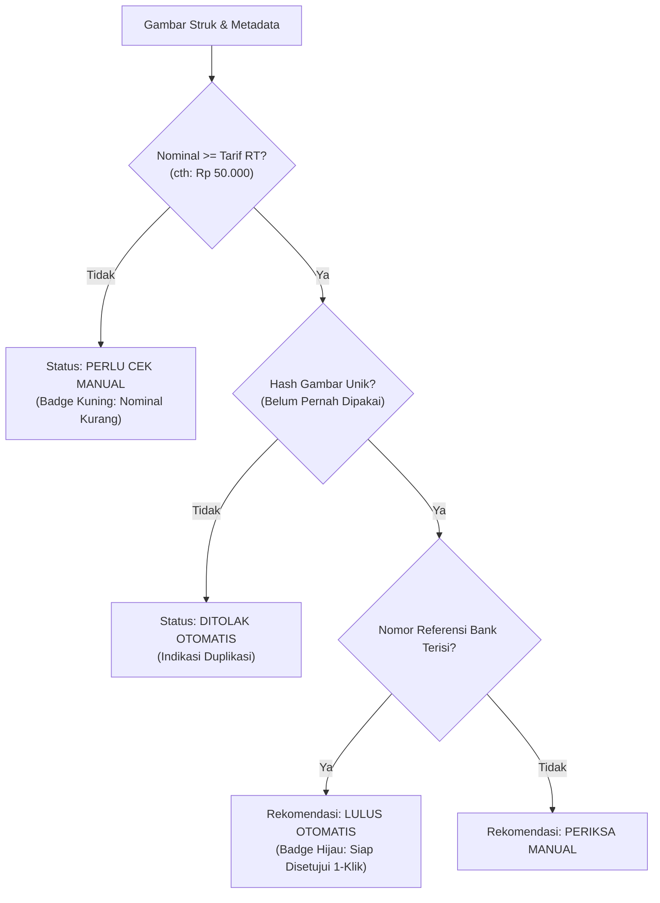

# Validasi Cerdas (OCR) & Laporan Rekapitulasi per Blok (Tahap 2)

Dokumen ini menjelaskan implementasi teknis dari **Tahap 2**: mesin validasi cerdas berbasis aturan (*rule-based OCR parser*), kartu iuran digital 12 bulan di sisi warga, serta matriks rekapitulasi kepatuhan kas per blok.

---

## 1. Mesin Validasi Cerdas (*Rule-Based OCR Engine*)

Saat pengurus RT membuka jendela verifikasi bukti bayar, sistem mengevaluasi integritas transaksi secara otomatis:



### Logika Evaluasi di `js/app.js`:
```javascript
const tarifWajib = Number(settings.tarifIuranBulanan) || 50000;

if (Number(bukti.nominal) >= tarifWajib) {
  ocrBadge.className = 'bg-emerald-200 text-emerald-900';
  ocrBadge.textContent = 'LULUS OTOMATIS';
  ocrDesc.innerHTML = `Status transaksi sah • Nominal cocok (${formatRupiah(bukti.nominal)}) • Rekening tujuan terverifikasi Kas RT • Ref Bank unik.`;
} else {
  ocrBadge.className = 'bg-amber-200 text-amber-900';
  ocrBadge.textContent = 'PERLU CEK MANUAL';
  ocrDesc.innerHTML = `Peringatan: Nominal yang dibayarkan (${formatRupiah(bukti.nominal)}) kurang dari tarif standar bulanan (${formatRupiah(tarifWajib)}).`;
}
```

---

## 2. Matriks Laporan Rekapitulasi 12 Bulan per Blok

Untuk memantau kedisiplinan iuran seluruh blok (Blok A, Blok B, Blok C) sepanjang tahun penagihan, sistem menyusun tabel matriks 12 kolom (Januari s/d Desember):

### Formula Agregasi Kepatuhan:
$$\text{Persentase Kepatuhan (\%)} = \left( \frac{\text{Jumlah Unit Rumah Lunas}}{\text{Total Unit Rumah Terdaftar}} \right) \times 100\%$$

$$\text{Total Realisasi Kas Unit} = \sum_{m=1}^{12} \text{Nominal Terverifikasi}(m)$$

### Indikator Visual Tabel:
* **`✓` (Centang Hijau):** Pembayaran periode tersebut telah diverifikasi dan masuk ke pembukuan kas.
* **`-` (Strip Abu-abu):** Warga belum membayar (menunggak) pada bulan yang bersangkutan.

---

## 3. Kartu Iuran Digital Warga di `bayar.html`

Pada portal publik warga, disediakan komponen visual **Kartu Iuran Digital 12 Bulan**:
* Menampilkan kisi (*grid*) 12 kotak bulan untuk tahun berjalan.
* Warga yang telah melunasi iuran Oktober akan melihat label hijau `✓ Lunas` di kotak `Okt`, sedangkan bulan yang belum dibayar berlabel `Belum`.
* Fitur ini menghilangkan kebutuhan kartu iuran manual berbahan kertas yang rentan hilang atau sobek.

---

## 4. Format Cetak Resmi A4 Landscape & Ekspor CSV

### A. Cetak Dokumen A4 Landscape
Menggunakan media cetak CSS khusus (`body.printing-laporan #printable-laporan-iuran`):
* Orientasi *landscape* memastikan ke-12 kolom bulan tercetak rapi tanpa terpotong.
* Dilengkapi kop surat resmi kelurahan/RT/RW dan kolom tanda tangan ganda:
  * Sisi Kiri: Mengetahui, **Ketua RT**.
  * Sisi Kanan: Dicetak pada tanggal berjalan, **Bendahara Kas RT**.

### B. Ekspor Data CSV/Excel
Fungsi `exportLaporanCSV()` menghasilkan berkas UTF-8 BOM CSV yang kompatibel langsung dengan Microsoft Excel tanpa masalah encoding:
```text
No,Blok,No Rumah,Nama Penghuni,Jan,Feb,Mar,Apr,Mei,Jun,Jul,Agu,Sep,Okt,Nov,Des,Total Bayar
1,"Blok A","12","H. Bambang Sudrajat","-","-","-","-","-","-","-","-","-","LUNAS","-","-","50000"
2,"Blok A","14","Hendra Wijaya","-","-","-","-","-","-","-","-","-","LUNAS","-","-","50000"
```

